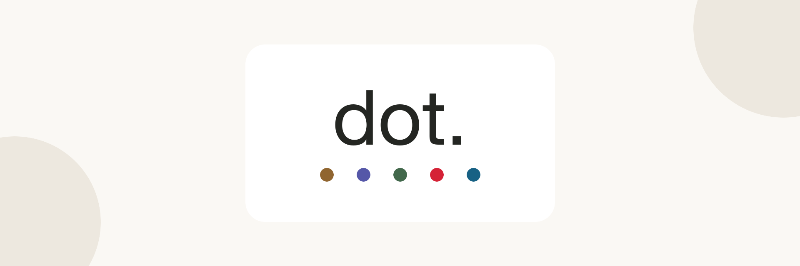

# README presentation

Use a short badge row near the top of each repository README, after the title
and before the main content. Follow it with a text navigation row for the
places readers need most. This layout also works for independent projects
with their existing names and identity.

- Use the same flat, two-part badge style with a readable icon and label.
  Keep the row short. Common choices are Releases, Docs, Support and Reddit.
- Link badges to real destinations. Use version or download badges only when
  the project publishes the corresponding data. Avoid invented stats, status
  badges for disabled workflows and decorative duplicates.
- Put quick links beneath the badges. Use meaningful text and separate links
  with a vertical bar. Prefer the actual release, documentation or support
  page for the project.
- On portfolio pages and About sections, [use the social icon tiles](../foundation/social/)
  for approved links. Render them at 32 points with accessible names. Keep
  icon artwork and backgrounds consistent. Provide a text fallback where
  inline images are unavailable. Read owner-approved destinations from the
  shared Credits data, and omit services that have no confirmed account.
- For independent repositories, label the Reddit destination as Max’s dot.
  profile. Keep project support and branding distinct.

Include a visible **Support on Ko-fi** link in the README navigation or
Contact section. Use https://ko-fi.com/somamill, the support destination in
the shared Credits data. If using an icon tile, retain an accessible name.
On independent projects, label it **Support Max on Ko-fi** so the destination
is clear. Keep each project's own support link for help and bug reports.

The GitHub, Reddit and Ko-fi glyphs are from [Simple Icons at 32e0300](https://github.com/simple-icons/simple-icons/tree/32e030086fdc605196391aab28519b14dc4295b4).
They identify those destinations. Their trademarks belong to their owners.

## Social artwork

Use the individual [GitHub](../foundation/social/github.png), [Reddit](../foundation/social/reddit.png) and [Ko-fi](../foundation/social/kofi.png) tiles as separate links. Keep the rounded background and high-contrast service glyphs consistent. Give each link an accessible name and follow the platform’s target-size guidance. The strip above is a preview. Use the destinations in the [shared Credits data](../foundation/credits.json). Add future networks once the owner confirms their profile URLs.

| Asset | Export | Use |
| --- | --- | --- |
| [dot. Reddit avatar](../foundation/social/reddit/avatar.png) | 256 × 256 PNG | Keep the centered mark legible in a small circular crop. |
| [dot. Reddit banner](../foundation/social/reddit/banner.png) | 1920 × 640 PNG | Keep the wordmark and accents in the middle so outer decoration can crop. |

For additional dot. social profiles, check the platform’s current artwork constraints and adapt the crop from the kit. Preview the avatar at small sizes and check the banner in narrow and wide layouts. After publishing, reload the profile and check both images and social links. Keep approved platform exports here for future use.
